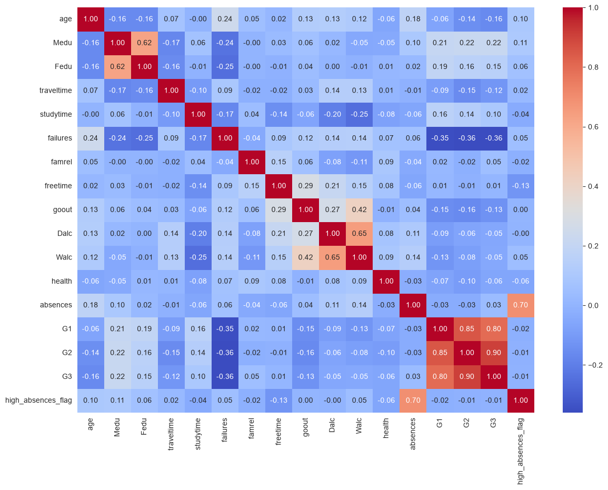
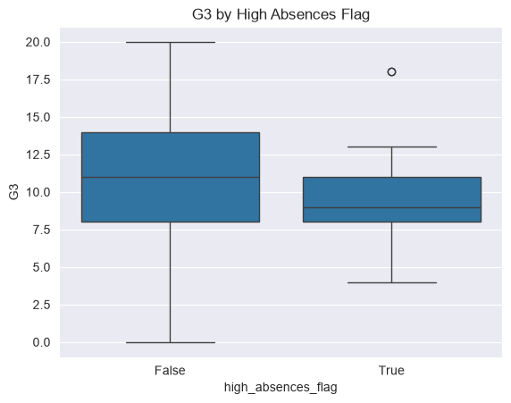
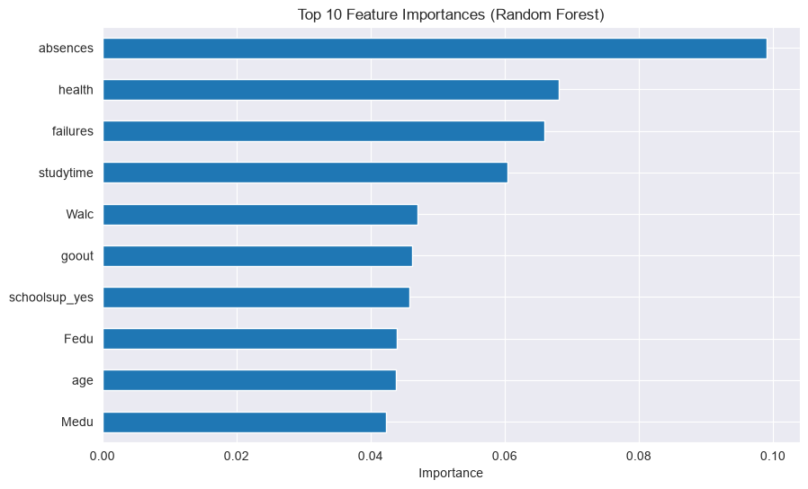

# Student Performance Analysis

This project analyzes the **Student Performance Dataset**, which contains 33 features describing students' academic results, family background, lifestyle, and personal characteristics.
The dataset is sourced from [Kaggle](https://www.kaggle.com/datasets/devansodariya/student-performance-data/data) and is based on a survey of secondary school students in a math course.

## 🎯 Research Questions

1. Is alcohol consumption related to academic performance?
2. Which factors are the strongest predictors of the final grade?
3. Does the occupation of parents influence student grades?
4. Does the student's gender affect academic performance?

## 📊 Dataset Description

- 395 rows, 33 columns
- Mix of numeric and categorical features
- Covers demographics, family background, lifestyle, and academic performance (G1, G2, G3)

## 🧹 Data Cleaning

- No missing values or duplicates found
- `absences` showed outliers beyond ~20 (confirmed via IQR and boxplot) — flagged as `high_absences_flag` rather than removed, since it represents a real subgroup of students (15 students, ~4%)
- 38 students had G3=0, likely representing non-completion of the final exam rather than genuine low performance — excluded from the modeling dataset

## 📈 EDA — Key Findings



- G1 and G2 correlate very strongly with G3 (0.80, 0.90) — flagged as a data leakage risk for modeling
- `failures` is the most consistent predictor of G3 across all analysis methods (correlation: -0.36)
- `absences` and `Mjob=health` show weak linear correlation with G3, but strong non-linear signal (see Feature Importance below) — a good example of why relying on a single method can be misleading



## 🧠 Modeling Results

| Model | Features | MAE | RMSE |
|---|---|---|---|
| Linear Regression | Without G1/G2 | 2.30 | 2.75 |
| Random Forest | Without G1/G2 | 2.23 | 2.73 |
| Linear Regression (leakage demo) | With G1/G2 | 0.67 | 0.90 |

Including G1/G2 improves MAE by ~3.4x, clearly demonstrating the effect of data leakage — prior grades essentially reveal the answer rather than serve as genuine predictors.



Top features (Random Forest, without G1/G2): `absences`, `health`, `failures`, `studytime`, `Walc`. `failures` is confirmed by both correlation and feature importance; `absences`/`health` show non-linear effects not captured by linear correlation.

## 📋 Answers to Research Questions

**1. Alcohol consumption?** No strong evidence — very weak correlation with G3 (-0.05).

**2. Strongest predictors?** `failures` most consistently; `absences`/`health` show non-linear importance.

**3. Parental occupation?** Moderate effect — students with mothers in healthcare show higher median grades (~13) vs. stay-at-home mothers (~10), though the healthcare subgroup is small (34 students).

**4. Gender?** Small effect — male students show slightly higher median grades (~11 vs ~10), not dramatic.

## 🛠 How to Run Locally 

```bash
git clone https://github.com/Yan-Pasichnyi/student-performance-analysis.git
cd student-performance-analysis
pip install -r requirements.txt
jupyter notebook notebooks/analasis.ipynb
```

## 📁 Project Structure

```
student-performance-analysis/
├── data/
│   ├── raw/
│   └── processed/
├── notebooks/
│   └── analasis.ipynb
├── images/
├── README.md
└── requirements.txt
```
